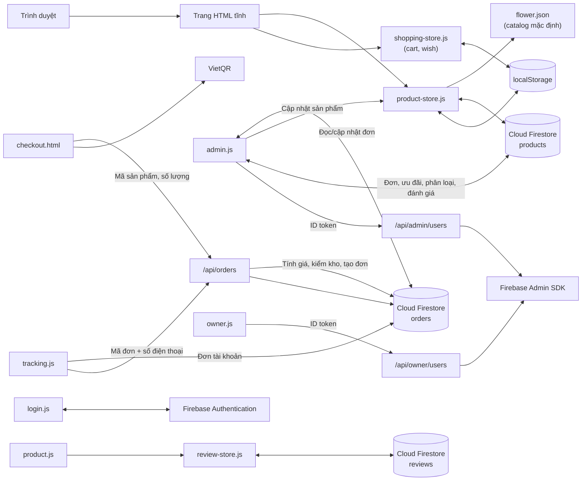

# FlowerFlow: Kiến trúc kỹ thuật

Tài liệu này mô tả kiến trúc, luồng dữ liệu và các module chính của website. Hướng dẫn cài đặt và tổng quan dự án nằm ở [README gốc](../README.md).

## Tổng quan

FlowerFlow là ứng dụng frontend tĩnh (HTML, CSS, JavaScript thuần, không có bước build) kết hợp với:

- **Firebase Authentication** để đăng nhập khách hàng và quản trị viên.
- **Cloud Firestore** để lưu catalog, đánh giá và đơn hàng dùng chung giữa các thiết bị.
- **Vercel Functions** (`api/`) để chạy các thao tác cần Firebase Admin SDK.
- **`localStorage`** để cache catalog và lưu giỏ hàng, danh sách yêu thích trên trình duyệt.

## Các module chính

| Khu vực | Tệp | Trách nhiệm |
| --- | --- | --- |
| Header và footer | `store-header.js/.css`, `store-footer.js/.css` | Chèn header (tìm kiếm, tài khoản, yêu thích, đơn hàng, giỏ hàng, menu mobile) và footer cho các trang cửa hàng |
| Trang chủ | `index.html`, `homepage.css` | Giới thiệu, danh mục nổi bật, điều hướng |
| Catalog | `product-store.js`, `flower.json` | Tải catalog mặc định, đồng bộ hai chiều với Firestore, cache vào `localStorage`, lắng nghe thay đổi theo thời gian thực |
| Danh mục và chi tiết | `product.html`, `product.js`, `product-categories.js`, `product-names.js`, `related-products.js` | Tìm kiếm, lọc, sắp xếp; trang chi tiết, thư viện ảnh, gợi ý sản phẩm liên quan |
| Đánh giá | `review-store.js` | Đọc đánh giá công khai và gửi đánh giá mới (yêu cầu đăng nhập) lên Firestore |
| Giỏ hàng và yêu thích | `shopping-store.js`, `cart.html`, `wish.html`, `wish.js` | Dùng chung khóa `cart`/`wish`, gộp dòng trùng, kiểm tra tồn kho |
| Thanh toán | `checkout.html`, `placeorder.html` | Thông tin giao hàng, áp dụng ưu đãi, mã QR chuyển khoản, tạo đơn |
| Theo dõi đơn | `tracking.html`, `tracking.js`, `order-status.js` | Tra cứu theo mã đơn và số điện thoại; liệt kê đơn của tài khoản đang đăng nhập |
| Tài khoản | `login.*`, `account.*`, `forgot-password.*` | Đăng ký, đăng nhập, khôi phục mật khẩu, hồ sơ |
| Tiền tệ | `currency.js` | Định dạng giá sang VND (catalog lưu giá theo USD) |
| Liên hệ | `contact-tools.js/.css` | Thanh liên hệ Facebook và Zalo (ẩn trên trang quản trị) |
| Quản trị | `admin.html`, `admin.js`, `admin.css` | Sản phẩm, danh mục, ưu đãi, đơn hàng, xác minh thanh toán QR, doanh thu, đánh giá, lời nhắn, người dùng. Dữ liệu khách gửi được escape trước khi hiển thị để chống XSS |
| Owner | `owner.html`, `owner.js` | Cấp hoặc gỡ quyền admin |
| API | `api/admin/users.js`, `api/owner/users.js`, `api/orders.js`, `lib/firebase-admin.js` | Xác minh quyền quản trị và tra cứu đơn khách bằng mã đơn cùng số điện thoại |

## Dữ liệu

### Nơi lưu trữ

| Dữ liệu | Nơi lưu | Đồng bộ giữa thiết bị |
| --- | --- | :---: |
| Catalog sản phẩm | Firestore `products`, cache `localStorage.flowerInventory` | ✅ |
| Trạng thái khởi tạo catalog | Firestore `metadata/productCatalog` | ✅ |
| Đánh giá trên trang sản phẩm | Firestore `reviews` | ✅ |
| Tài khoản Firebase, vai trò | Firebase Authentication (custom claims) | ✅ |
| Giỏ hàng, yêu thích | `localStorage.cart`, `localStorage.wish` | ❌ |
| Đơn hàng mới | `/api/orders` xác minh rồi ghi Firestore `orders` | ✅ |
| Đánh giá trong trang quản trị (phản hồi, hoàn thành) | Firestore `reviews` | ✅ |
| Lời nhắn của khách và câu trả lời | Trường `orderNote`, `orderNoteReply`, `orderNoteCompletedAt` của đơn trong `orders` | ✅ |
| Phản hồi cũ trên trình duyệt | Firestore `messages` (chuyển khi quản trị đăng nhập) | ✅ |
| Phân loại | Firestore `metadata/storeCategories` (bản cache ở `localStorage.flowerCategories`) | ✅ |
| Ưu đãi | Firestore `metadata/activePromotions` (bản cache ở `localStorage`) | ✅ |
| Phiên đăng nhập | `localStorage.loggedUser` | ❌ |

Trang quản trị không còn tự điền dữ liệu demo cho đánh giá và lời nhắn; cả hai đều đọc từ Firestore.

Phản hồi cũ trong `localStorage.flowerMessages` được chuyển sang Firestore `messages` khi quản trị đăng nhập. Đánh giá cũ được hợp nhất một lần với Firestore; bản cache đánh giá cục bộ của khách vẫn được giữ để tránh gửi trùng trên cùng trình duyệt.

### Đồng bộ catalog

1. Khi tải trang, `product-store.js` đọc cache cục bộ và `flower.json`.
2. Nếu Firebase đã cấu hình, catalog được đọc từ Firestore và gộp với catalog mặc định (`mergeCatalogProducts`).
3. Chỉ tài khoản có claim `admin: true` mới ghi được sản phẩm còn thiếu lên Firestore khi khởi tạo lần đầu.
4. Sau đó trang đăng ký `onSnapshot` để nhận thay đổi theo thời gian thực.

### Trạng thái đơn hàng

Đơn hàng có bốn trạng thái, định nghĩa trong `order-status.js`:

| Trạng thái | Ý nghĩa |
| --- | --- |
| Chờ xác nhận | Trạng thái mặc định khi khách vừa đặt hàng |
| Đang giao | Admin đã xác nhận và đang giao hàng |
| Đã giao | Đơn đã giao thành công |
| Đã hủy | Đơn bị hủy hoặc giao thất bại |

Admin có thể chuyển đơn sang bất kỳ trạng thái nào. Các tên trạng thái cũ (ví dụ "Đã vận chuyển", "Giao hàng thất bại") được tự động chuyển sang tên mới tương ứng.

Đơn mới được gửi tới `/api/orders`. Backend chỉ nhận mã sản phẩm, số lượng và thông tin giao hàng; tự đọc giá, tồn kho, ưu đãi từ Firestore, tính lại tổng tiền và dành tồn kho trong cùng một transaction trước khi ghi đơn. Hệ thống giữ hàng 30 phút với QR chưa xác minh và 24 giờ với COD; đơn hết hạn hoặc bị hủy sẽ được hoàn kho bằng transaction. QR đã xác minh giữ hàng đến khi hoàn tất hoặc hủy đơn. Đơn đã giao chốt phần tồn kho đã bán, không hoàn kho khi dọn đơn. Việc dọn chạy khi báo giá/đặt hàng, lúc quản trị mở dashboard và theo lịch Vercel. Khách đã đăng nhập chỉ đọc được đơn có UID của mình; khách chưa đăng nhập tra cứu qua API bằng mã đơn và số điện thoại. Chỉ tài khoản có claim `admin: true` được xem danh sách, cập nhật hoặc xóa đơn. Dữ liệu đơn cũ trong `localStorage.flowerOrders` không tự động chuyển lên Firestore.

Đơn QR ở trạng thái chờ xác minh cho đến khi admin đối chiếu sao kê và bấm “Xác nhận đã nhận tiền”. Thao tác này đặt `paymentVerified: true`, `paymentStatus: "Đã thanh toán"` và `paidAt`; chỉ admin được ghi các trường này (Security Rules). Đơn đã xác minh không bị dọn khi hết thời gian giữ hàng và được tính vào doanh thu sau khi giao. Dự án chưa tích hợp API/webhook ngân hàng nên chưa có đối soát tự động.

Tra cứu công khai gửi mã đơn và số điện thoại bằng `POST`; backend giới hạn 20 lượt mỗi IP trong 10 phút, lưu khóa IP dưới dạng HMAC và tự xóa bản ghi giới hạn sau 24 giờ. Kết quả công khai chỉ gồm mã đơn, trạng thái, thời gian dự kiến và lịch sử trạng thái; địa chỉ, số điện thoại, người nhận, sản phẩm và thông tin thanh toán chỉ được đọc khi khách đăng nhập đúng tài khoản sở hữu đơn. Mã đơn không khớp và số điện thoại không khớp cùng trả về một lỗi.

## Bảo mật Firestore

Quy tắc nằm trong `firestore.rules` (khai báo trong `firebase.json`). Tóm tắt:

- `products`: ai cũng đọc được; chỉ tài khoản có claim `admin: true` được tạo, sửa, xóa.
- `reviews`: ai cũng đọc được; người dùng đã đăng nhập được tạo đánh giá đúng schema (`productIds`, `productName`, `customerName`, `rating` 1–5, `comment` tối đa 1000 ký tự, `createdAt` là thời điểm server); chỉ admin được sửa hoặc xóa.
- `metadata`: chỉ admin, ngoại trừ đọc tài liệu `activePromotions` để hiển thị ưu đãi công khai.
- `orders`: không cho client tạo trực tiếp; API backend tạo đơn sau khi tính giá và xác minh tồn kho. Khách đã đăng nhập chỉ đọc đơn của UID mình; chỉ admin được đọc toàn bộ, cập nhật hoặc xóa.
- Các collection khác, bao gồm `orderRequests` và `orderLookupLimits`, bị từ chối bởi quy tắc mặc định; chỉ backend dùng Firebase Admin SDK mới truy cập được.
- Mọi đường dẫn khác bị từ chối.

Triển khai: `firebase deploy --only firestore:rules,firestore:indexes`. Lệnh này cũng khai báo TTL 24 giờ cho các bản ghi giới hạn tra cứu; Firestore có thể xóa bản ghi trễ tối đa khoảng một ngày sau hạn. API tạo/tra cứu đơn cần `FIREBASE_SERVICE_ACCOUNT_JSON` và `FIREBASE_PROJECT_ID` trong Vercel; tài khoản dịch vụ cần quyền đọc/ghi Firestore (Cloud Datastore User). Cấu hình `CRON_SECRET` trong Vercel để bảo vệ lượt dọn đơn theo lịch. Đánh giá và đơn cũ chỉ lưu trong `localStorage` không tự chia sẻ giữa các thiết bị.

## Xác thực

- **Email/Password và Google** dùng Firebase Authentication. Tài khoản Google luôn được tạo với vai trò khách hàng.
- Không có chế độ đăng nhập cục bộ. Khi Firebase Authentication chưa cấu hình hoặc không hoạt động, đăng ký/đăng nhập/khôi phục mật khẩu sẽ dừng và báo lỗi; mật khẩu không được lưu trong trình duyệt.
- **Quản trị:** trang `admin.html` kiểm tra claim `admin: true` trên ID token; API phía server kiểm tra lại claim này độc lập với giao diện.

## Rà soát quyền truy cập

- `/api/admin/users`: chỉ POST, xác minh Firebase ID token và yêu cầu claim `admin: true`.
- `/api/owner/users`: chỉ POST, xác minh Firebase ID token và yêu cầu claim `role: "owner"`; chủ cửa hàng không thể tự đổi quyền, và tài khoản chủ cửa hàng khác không bị thay đổi qua API này.
- `/api/orders`: báo giá và tra cứu là chức năng công khai có kiểm tra dữ liệu; tạo đơn cho phép khách chưa đăng nhập theo luồng mua hàng, nhưng server tự tính giá/kiểm tra kho và dùng transaction. Nếu có token thì token được xác minh. Dọn đơn hết hạn yêu cầu `CRON_SECRET` hoặc token admin hợp lệ.
- Các endpoint quản trị không dựa vào việc ẩn nút trên giao diện; quyền được kiểm tra ở server hoặc Firestore Security Rules.
- Repo hiện có cấu hình Firestore Rules nhưng không tìm thấy đường dẫn dùng MockAPI, Realtime Database hoặc Firebase Storage. Quy tắc đã kiểm tra trong mã nguồn; trạng thái triển khai thực tế, Authorized domains và giới hạn API key cần xác minh trong Firebase Console.
- Firebase Web API key được nhúng phía client để khởi tạo SDK; đây không phải khóa dịch vụ bí mật. Cần giới hạn API key theo website/API phù hợp và chỉ cấp quyền dữ liệu qua Firebase Rules.

## Ghi chú phát triển

- Luôn chạy qua HTTP (`python -m http.server` hoặc `vercel dev`), không mở bằng `file://`.
- Các script được nạp kèm tham số phiên bản (`?v=N`) để tránh cache trình duyệt; tăng số này khi thay đổi file JS/CSS tương ứng.
- Firebase Web SDK được nạp từ CDN `gstatic.com` (phiên bản 11.6.0).
- Chạy `npm test` trước khi commit.
