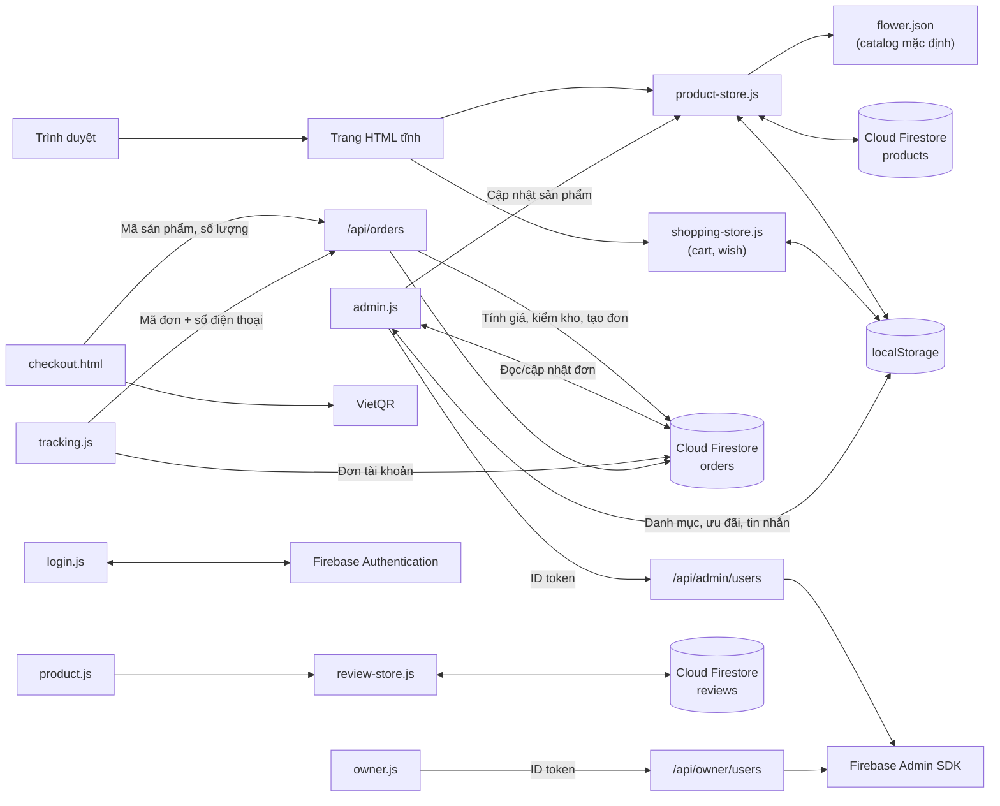

# FlowerFlow: Kiến trúc kỹ thuật

Tài liệu này mô tả kiến trúc, luồng dữ liệu và các module chính của website. Hướng dẫn cài đặt và tổng quan dự án nằm ở [README gốc](../README.md).

## Tổng quan

FlowerFlow là ứng dụng frontend tĩnh (HTML, CSS, JavaScript thuần, không có bước build) kết hợp với:

- **Firebase Authentication** để đăng nhập khách hàng và quản trị viên.
- **Cloud Firestore** để lưu catalog, đánh giá và đơn hàng dùng chung giữa các thiết bị.
- **Vercel Functions** (`api/`) để chạy các thao tác cần Firebase Admin SDK.
- **`localStorage`** để cache catalog và lưu dữ liệu tạm trên trình duyệt (giỏ hàng, ưu đãi, tin nhắn...).

## Các module chính

| Khu vực | Tệp | Trách nhiệm |
| --- | --- | --- |
| Header và footer | `store-header.js/.css`, `store-footer.js/.css` | Chèn header (tìm kiếm, tài khoản, yêu thích, đơn hàng, giỏ hàng, menu mobile) và footer cho các trang cửa hàng |
| Trang chủ | `index.html`, `homepage.css` | Giới thiệu, danh mục nổi bật, điều hướng |
| Catalog | `product-store.js`, `flower.json` | Tải catalog mặc định, đồng bộ hai chiều với Firestore, cache vào `localStorage`, lắng nghe thay đổi theo thời gian thực |
| Danh mục và chi tiết | `product.html`, `product.js`, `product-categories.js`, `product-names.js`, `related-products.js` | Tìm kiếm, lọc, sắp xếp; trang chi tiết, thư viện ảnh, gợi ý sản phẩm liên quan |
| Đánh giá | `review-store.js` | Đọc đánh giá công khai và gửi đánh giá mới (yêu cầu đăng nhập) lên Firestore |
| Giỏ hàng và yêu thích | `shopping-store.js`, `cart.html`, `wish.html`, `wish.js` | Dùng chung khóa `cart`/`wish`, gộp dòng trùng, kiểm tra tồn kho |
| Thanh toán | `checkout.html`, `placeorder.html` | Thông tin giao hàng, áp dụng ưu đãi, mã QR chuyển khoản, tạo đơn |
| Theo dõi đơn | `tracking.html`, `tracking.js`, `order-status.js` | Tra cứu theo mã đơn và số điện thoại; liệt kê đơn của tài khoản đang đăng nhập |
| Tài khoản | `login.*`, `account.*`, `forgot-password.*` | Đăng ký, đăng nhập, khôi phục mật khẩu, hồ sơ |
| Tiền tệ | `currency.js` | Định dạng giá sang VND (catalog lưu giá theo USD) |
| Liên hệ | `contact-tools.js/.css` | Thanh liên hệ Facebook và Zalo (ẩn trên trang quản trị) |
| Quản trị | `admin.html`, `admin.js`, `admin.css` | Sản phẩm, danh mục, ưu đãi, đơn hàng, doanh thu, đánh giá, tin nhắn, người dùng |
| Owner | `owner.html`, `owner.js` | Cấp hoặc gỡ quyền admin |
| API | `api/admin/users.js`, `api/owner/users.js`, `api/orders.js`, `lib/firebase-admin.js` | Xác minh quyền quản trị và tra cứu đơn khách bằng mã đơn cùng số điện thoại |

## Dữ liệu

### Nơi lưu trữ

| Dữ liệu | Nơi lưu | Đồng bộ giữa thiết bị |
| --- | --- | :---: |
| Catalog sản phẩm | Firestore `products`, cache `localStorage.flowerInventory` | ✅ |
| Trạng thái khởi tạo catalog | Firestore `metadata/productCatalog` | ✅ |
| Đánh giá trên trang sản phẩm | Firestore `reviews` | ✅ |
| Tài khoản Firebase, vai trò | Firebase Authentication (custom claims) | ✅ |
| Giỏ hàng, yêu thích | `localStorage.cart`, `localStorage.wish` | ❌ |
| Đơn hàng mới | `/api/orders` xác minh rồi ghi Firestore `orders` | ✅ |
| Đánh giá trong trang quản trị, tin nhắn | `localStorage.flowerReviews`, `localStorage.flowerMessages` | ❌ |
| Danh mục | `localStorage.flowerCategories` | ❌ |
| Ưu đãi | Firestore `metadata/activePromotions` (bản cache ở `localStorage`) | ✅ |
| Phiên đăng nhập | `localStorage.loggedUser` | ❌ |

### Đồng bộ catalog

1. Khi tải trang, `product-store.js` đọc cache cục bộ và `flower.json`.
2. Nếu Firebase đã cấu hình, catalog được đọc từ Firestore và gộp với catalog mặc định (`mergeCatalogProducts`).
3. Chỉ tài khoản có claim `admin: true` mới ghi được sản phẩm còn thiếu lên Firestore khi khởi tạo lần đầu.
4. Sau đó trang đăng ký `onSnapshot` để nhận thay đổi theo thời gian thực.

### Trạng thái đơn hàng

Đơn hàng có bốn trạng thái, định nghĩa trong `order-status.js`:

| Trạng thái | Ý nghĩa |
| --- | --- |
| Chờ xác nhận | Trạng thái mặc định khi khách vừa đặt hàng |
| Đang giao | Admin đã xác nhận và đang giao hàng |
| Đã giao | Đơn đã giao thành công |
| Đã hủy | Đơn bị hủy hoặc giao thất bại |

Admin có thể chuyển đơn sang bất kỳ trạng thái nào. Các tên trạng thái cũ (ví dụ "Đã vận chuyển", "Giao hàng thất bại") được tự động chuyển sang tên mới tương ứng.

Đơn mới được gửi tới `/api/orders`. Backend chỉ nhận mã sản phẩm, số lượng và thông tin giao hàng; tự đọc giá, tồn kho, ưu đãi từ Firestore, tính lại tổng tiền và dành tồn kho trong cùng một transaction trước khi ghi đơn. Hủy hoặc xóa đơn sẽ hoàn tồn kho bằng transaction. Khách đã đăng nhập chỉ đọc được đơn có UID của mình; khách chưa đăng nhập tra cứu qua API bằng mã đơn và số điện thoại. Chỉ tài khoản có claim `admin: true` được xem danh sách, cập nhật hoặc xóa đơn. Dữ liệu đơn cũ trong `localStorage.flowerOrders` không tự động chuyển lên Firestore.

Đơn QR luôn ở trạng thái chờ xác minh. Dự án chưa tích hợp API/webhook ngân hàng, vì vậy không có luồng nào tự đánh dấu đơn QR đã thanh toán hoặc tính vào doanh thu.

## Bảo mật Firestore

Quy tắc nằm trong `firestore.rules` (khai báo trong `firebase.json`). Tóm tắt:

- `products`: ai cũng đọc được; chỉ tài khoản có claim `admin: true` được tạo, sửa, xóa.
- `reviews`: ai cũng đọc được; người dùng đã đăng nhập được tạo đánh giá đúng schema (`productIds`, `productName`, `customerName`, `rating` 1–5, `comment` tối đa 1000 ký tự, `createdAt` là thời điểm server); chỉ admin được sửa hoặc xóa.
- `metadata`: chỉ admin, ngoại trừ đọc tài liệu `activePromotions` để hiển thị ưu đãi công khai.
- `orders`: không cho client tạo trực tiếp; API backend tạo đơn sau khi tính giá và xác minh tồn kho. Khách đã đăng nhập chỉ đọc đơn của UID mình; chỉ admin được đọc toàn bộ, cập nhật hoặc xóa.
- Mọi đường dẫn khác bị từ chối.

Triển khai: `firebase deploy --only firestore:rules`. API tạo/tra cứu đơn cần `FIREBASE_SERVICE_ACCOUNT_JSON` và `FIREBASE_PROJECT_ID` trong Vercel; tài khoản dịch vụ cần quyền đọc/ghi Firestore (Cloud Datastore User). Đánh giá và đơn cũ chỉ lưu trong `localStorage` không tự chia sẻ giữa các thiết bị.

## Xác thực

- **Email/Password và Google** dùng Firebase Authentication. Tài khoản Google luôn được tạo với vai trò khách hàng.
- **Chế độ demo:** nếu Firebase chưa bật provider Email/Password, tài khoản được lưu trong `localStorage` của trình duyệt. Mật khẩu ở chế độ này **không được mã hóa**; chỉ dùng để thử nghiệm.
- **Quản trị:** trang `admin.html` kiểm tra claim `admin: true` trên ID token; API phía server kiểm tra lại claim này độc lập với giao diện.

## Ghi chú phát triển

- Luôn chạy qua HTTP (`python -m http.server` hoặc `vercel dev`), không mở bằng `file://`.
- Các script được nạp kèm tham số phiên bản (`?v=N`) để tránh cache trình duyệt; tăng số này khi thay đổi file JS/CSS tương ứng.
- Firebase Web SDK được nạp từ CDN `gstatic.com` (phiên bản 11.6.0).
- Chạy `npm test` trước khi commit.
