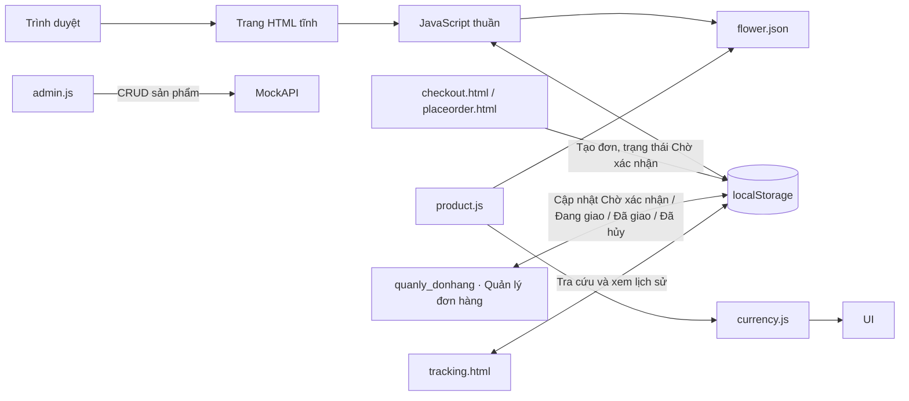

# casual-metal-9545
## Kiến trúc hệ thống

### Tổng quan

Đây là ứng dụng frontend tĩnh, dùng HTML, CSS và JavaScript thuần. Không có máy chủ ứng dụng riêng hoặc bước build. Các trang chạy trong trình duyệt; dữ liệu sản phẩm mẫu được tải từ `flower.json`, còn một số trạng thái được lưu trong `localStorage`.

### Các khu vực chính

| Khu vực | Tệp tiêu biểu | Trách nhiệm |
| --- | --- | --- |
| Header và footer dùng chung | `store-header.js`, `store-header.css`, `store-footer.js`, `store-footer.css` | Chèn header (tìm kiếm, tài khoản, yêu thích, đơn hàng, giỏ hàng, menu mobile) và footer cho các trang cửa hàng |
| Trang chủ | `index.html`, `homepage.css` | Nội dung giới thiệu, danh mục và điều hướng |
| Danh mục và chi tiết hoa | `product.html`, `product.js`, `product.css`, `related-products.js` | Tải catalog, tìm kiếm, lọc, sắp xếp; xem chi tiết, gợi ý hoa cùng danh mục/loại hoa, thư viện ảnh, giá, tồn kho và số lượng |
| Giỏ hàng và yêu thích | `shopping-store.js`, `wish.html`, `wish.js`, `wish.css` | Dùng chung `localStorage` `cart`/`wish` cho trang danh mục, chi tiết, wishlist và checkout; gộp dòng sản phẩm, kiểm tra tồn kho và hiển thị trạng thái yêu thích |
| Kiểm thử trang sản phẩm và danh mục | `tests/product-page.test.js`, `tests/product-related.test.js`, `tests/product-categories.test.js`, `tests/product-store-sync.test.js`, `tests/shopping-store.test.js`, `tests/store-footer.test.js` | Chạy cả sáu bộ bằng `npm test` tại `flower.com` |
| Giỏ hàng | `cart.html`, `cart.css` | Cập nhật số lượng, xóa sản phẩm và tính tổng |
| Thanh toán và theo dõi đơn | `checkout.html`, `placeorder.html`, `tracking.html` | Thu thập thông tin giao hàng, xác nhận đơn và tra cứu trạng thái/lịch trình |
| Tài khoản demo | `login.html`, `login.js`, `account.html` | Đăng ký/đăng nhập, xem hồ sơ và đăng xuất |
| Quản trị sản phẩm | `admin.html`, `admin.js`, `admin.css` | Đọc, thêm, sửa và xóa sản phẩm qua MockAPI |

### Dữ liệu và tiền tệ

- `flower.json` chứa catalog mẫu; `product.js` đọc tệp này qua `fetch`, vì vậy cần mở ứng dụng qua HTTP thay vì mở trực tiếp bằng `file://`.
- `cart`, `wish`, `usersData` và `loggedUser` được lưu trong `localStorage` của trình duyệt. Dữ liệu này không đồng bộ giữa thiết bị hoặc người dùng.
- Đăng nhập email/mật khẩu dùng Firebase Authentication khi provider được bật. Nếu Firebase chưa bật Email/Password (hoặc chưa cấu hình), website lưu tài khoản demo trong `localStorage` để dùng trên cùng trình duyệt; dữ liệu không đồng bộ và mật khẩu demo không được mã hóa, vì vậy không dùng mật khẩu thật cho chế độ này. Tài khoản demo cũ cũng được thử trên đúng trình duyệt đã lưu tài khoản đó.
- Đăng nhập Google dùng Firebase Authentication và cần bật Google provider, cấu hình Firebase Web App cùng domain được phép trong Firebase Console.
- Nút tài khoản trên các trang cửa hàng mở trang hồ sơ khi đã đăng nhập; nếu chưa có phiên thì mở trang đăng nhập.
- Checkout hiện là luồng minh họa phía frontend; đơn hàng được lưu trong `localStorage`, không có xử lý thanh toán hoặc lưu đơn hàng phía máy chủ. Đơn mới ở trạng thái **Chờ xác nhận**; quản trị viên có thể cập nhật thành **Đang giao**, **Đã giao** hoặc **Đã hủy**. Khách tra cứu đơn bằng mã đơn hàng và số điện thoại trên trang theo dõi.
- `admin.js` gọi API MockAPI riêng để CRUD catalog quản trị.
- Trang `/owner.html` và API cấp/gỡ quyền admin hoạt động trên bản Vercel có cấu hình Firebase Admin. Xem [`../core/ADMIN-SETUP.md`](../core/ADMIN-SETUP.md) để cấu hình.
- Product names and descriptions are stored directly in `flower.json` in Vietnamese. `currency.js` formats catalog prices as VND; catalog/API prices remain in USD.

### Chạy và triển khai

Vì ứng dụng tĩnh có tải JSON bằng `fetch`, hãy chạy qua máy chủ HTTP cục bộ. Để triển khai trang cùng API quản trị, cấu hình Vercel theo hướng dẫn trong [`../core/ADMIN-SETUP.md`](../core/ADMIN-SETUP.md).

### Cấu hình Firebase Authentication

1. Tạo Firebase project và đăng ký Web App trong Firebase Console.
2. Vào **Authentication → Sign-in method**, bật **Email/Password** và **Google**.
3. Trong **Authentication → Settings → Authorized domains**, thêm domain triển khai (và `localhost` khi phát triển cục bộ).
4. Sao chép Firebase Web App config vào `firebase-config.js`. Firebase web config được dùng ở client; bảo vệ dữ liệu bằng cấu hình provider, Authorized domains và quy tắc bảo mật dịch vụ, không coi config này là bí mật.
5. Chạy website qua HTTP/HTTPS. Khi đã điền cấu hình, đăng ký/đăng nhập email và nút Google sẽ sử dụng Firebase; tài khoản Google luôn được tạo với vai trò khách hàng, không phải admin.

Khi chưa điền cấu hình Firebase, nút Google sẽ giải thích cấu hình còn thiếu; chế độ tài khoản cục bộ tiếp tục hoạt động như bản demo.

# Landing Page 

Hear you can see the landing page of our project :

# Sign-In /Sign -Up

# Product page

# Search Option

# WishList

# Cart Page

# Order Page

# Checkout page

